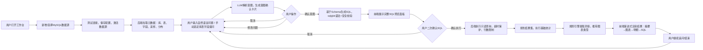

# 数据分析Agent MVP 设计文档
> 文档版本：V1.0
> 项目名称：基础数据分析Agent MVP
> 定位：最小可用端到端数据分析Agent，优先打通完整链路，强人工确认、只读安全、可解释，文件数据源仅预留扩展接口，暂不实现业务逻辑
> 技术栈推荐：后端 FastAPI + SQLAlchemy + sqlglot；前端 Vue3 / React；LLM 模块可插拔（支持通义千问、OpenAI、DeepSeek等）

## 目录
- [1. 项目概述](#1-项目概述)
  - [1.1 任务目标](#11-任务目标)
  - [1.2 核心目标](#12-核心目标)
  - [1.3 设计原则](#13-设计原则)
- [2. 功能范围](#2-功能范围)
  - [2.1 ✅ MVP必须实现功能](#21--mvp必须实现功能)
  - [2.2 ❌ 非目标（预留扩展点，暂不开发）](#22--非目标预留扩展点暂不开发)
- [3. 业务端到端流程](#3-业务端到端流程)
- [4. 系统整体架构](#4-系统整体架构)
  - [4.1 架构图文字说明](#41-架构图文字说明)
  - [4.2 模块依赖关系](#42-模块依赖关系)
- [5. 项目目录结构](#5-项目目录结构)
- [6. 数据模型定义](#6-数据模型定义)
  - [6.1 数据源模型 Datasource](#61-数据源模型-datasource)
  - [6.2 Agent会话状态 AgentSession](#62-agent会话状态-agentsession)
  - [6.3 意图确认卡片模型 IntentConfirmCard](#63-意图确认卡片模型-intentconfirmcard)
  - [6.4 SQL校验结果模型 SqlSecurityResult](#64-sql校验结果模型-sqlsecurityresult)
  - [6.5 查询结果模型 QueryResult](#65-查询结果模型-queryresult)
  - [6.6 分析输出模型 AnalysisResult](#66-分析输出模型-analysisresult)
- [7. REST API 接口定义](#7-rest-api-接口定义)
  - [7.1 数据源管理接口](#71-数据源管理接口)
  - [7.2 元数据探查接口](#72-元数据探查接口)
  - [7.3 Agent核心链路接口](#73-agent核心链路接口)
- [8. 前端页面与组件设计](#8-前端页面与组件设计)
  - [8.1 页面结构](#81-页面结构)
  - [8.2 组件详细说明](#82-组件详细说明)
- [9. 核心模块详细设计](#9-核心模块详细设计)
  - [9.1 数据源适配器模块](#91-数据源适配器模块)
  - [9.2 元数据工具模块 MetaTool](#92-元数据工具模块-metatool)
  - [9.3 LLM意图理解模块](#93-llm意图理解模块)
  - [9.4 SQL生成、语法与安全校验模块](#94-sql生成语法与安全校验模块)
  - [9.5 查询执行沙箱模块](#95-查询执行沙箱模块)
  - [9.6 基础统计分析模块](#96-基础统计分析模块)
  - [9.7 规则洞察提取模块](#97-规则洞察提取模块)
  - [9.8 可视化推荐模块](#98-可视化推荐模块)
- [10. 安全策略与人工确认机制](#10-安全策略与人工确认机制)
  - [10.1 双层人工确认机制（不可绕过）](#101-双层人工确认机制不可绕过)
  - [10.2 SQL多层安全防护](#102-sql多层安全防护)
  - [10.3 数据库账号安全建议](#103-数据库账号安全建议)
  - [10.4 异常处理与信息脱敏](#104-异常处理与信息脱敏)
- [11. 核心代码骨架](#11-核心代码骨架)
- [12. 端到端示例对话流程](#12-端到端示例对话流程)
- [13. 测试与验收清单](#13-测试与验收清单)
- [14. 后续扩展规划](#14-后续扩展规划)

## 1. 项目概述
### 1.1 任务目标
设计并实现**最基础数据分析Agent MVP**。目标优先打通端到端全链路，不追求高级智能与复杂工程化；全部功能采用最小可运行版本，严格避免过度设计。

### 1.2 核心目标
构建基础数据分析Agent，完整业务链路：
> 数据源连接 → 元数据获取 → 用户自然语言提问 → 意图理解与确认 → SQL生成与展示 → SQL人工确认 → 查询执行 → 简单统计分析 → 可视化推荐 → 基础洞察提取

**核心原则**：每一步可解释、可中断、可人工确认；系统默认**不会自动执行任何数据库操作**。

### 1.3 设计原则
1. **最小可用**：只实现闭环必需能力，砍掉非必要功能；
2. **安全优先**：只读模式，双层人工确认，禁止写库操作；
3. **可解释**：SQL完全透明，所有分析结论附带依据；
4. **可扩展**：抽象数据源接口，方便后续接入CSV/Excel/其他数据库；
5. **可插拔LLM**：意图理解、SQL生成模块和大模型解耦，可切换不同LLM服务商。

## 2. 功能范围
### 2.1 ✅ MVP必须实现功能
#### 2.1.1 数据源连接模块
- 仅实现MySQL数据源；
- 支持多组MySQL连接配置保存、切换；
- 连接参数：主机地址、端口、用户名、密码、数据库名；
- 支持测试连接、保存连接配置、切换当前激活数据源；
- 连接配置本地持久化（简单文件/轻量sqlite存储，MVP不引入复杂用户权限库）。

#### 2.1.2 元数据探查工具
连接成功后，获取元信息作为LLM上下文，**此阶段不会自动生成分析结论**
- 列出当前实例所有数据库；
- 列出指定数据库下全部数据表；
- 获取表结构：字段名、字段类型、注释、主键；
- 表采样数据：限制行数（默认10行）；
- 基础分布统计：空值数量、唯一值、最大值、最小值、简单频次分布。

#### 2.1.3 用户意图理解 & 意图确认卡片
用户输入自然语言问题，Agent解析输出意图，前端渲染**意图确认卡片**。
卡片内容：
- 用户原始问题
- Agent识别的分析意图
- 目标数据库、目标表、目标字段
- 拟生成SQL预览
- 查询风险等级（低/中）
- 操作按钮：确认 / 修改问题 / 取消

> 未确认意图，不会进入SQL生成流程。

#### 2.1.4 SQL生成、语法校验、安全控制
- 根据Schema上下文约束生成SQL；
- 使用sqlglot解析AST，做语法校验；
- 强制安全规则：
  - 只读，**仅允许SELECT**；
  - 禁止多语句执行（拦截`;`分割多条SQL）；
  - 拦截所有DDL/DML语句（CREATE/ALTER/DROP/INSERT/UPDATE/DELETE/TRUNCATE等）；
  - 自动追加LIMIT，默认上限1000行；
  - 设置查询超时，防止慢查询占用数据库资源；
- SQL完整展示在前端，支持复制；
- SELECT查询**执行前必须二次人工确认**。

#### 2.1.5 简单统计分析
查询拿到结果集后，执行轻量级统计，**无机器学习、复杂建模**
- 基础聚合：计数、求和、平均值、最大值、最小值；
- 分组聚合统计；
- 空值统计；
- TopN提取；
- 时间字段趋势计算；
- 分组对比统计。

#### 2.1.6 可视化（渐进式披露）
基于返回数据字段类型 + 用户问题，自动推荐图表，用户可手动切换图表类型。
支持图表类型：表格、柱状图、折线图、饼图。
渲染顺序（渐进披露，由摘要到明细）：
1. 文字摘要先行展示；
2. 推荐图表；
3. 明细数据表格；
4. 可折叠面板查看原始执行SQL。

#### 2.1.7 基础洞察提取（规则驱动）
规则引擎实现，非LLM深度推理；输出简短结论，附带判断依据。
- 异常检测：空值占比、极端值、阈值越界、数据明显偏离；
- 趋势分析：识别时间序列上升 / 下降 / 平稳波动；
- 对比分析：分组差异、Top/Bottom对比、同期时间对比。

#### 2.1.8 前端交互
- 数据源管理：新增、测试、编辑、删除、切换MySQL连接；
- 库表字段树选择器：数据库 → 表 → 字段树形选择；
- 自然语言输入框；
- 意图确认卡片组件；
- SQL预览确认面板；
- 结果面板：文字摘要、图表、明细表格、洞察卡片、SQL折叠面板；
- 硬性约束：所有数据库访问，必须人工确认按钮。

### 2.2 ❌ 非目标（预留扩展点，暂不开发）
- CSV / Excel 文件读取（仅定义抽象DataSourceAdapter接口占位）
- 多智能体协作
- 写库操作：INSERT/UPDATE/DELETE/DROP等
- 复杂细粒度权限系统、RBAC
- 大屏、复杂多维可视化
- 机器学习、预测模型、自动归因
- 向量数据库、长期会话记忆、复杂工作流引擎
- 分布式任务、异步任务队列

## 3. 业务端到端流程


1. 用户配置MySQL连接，测试连通性，保存并激活数据源；
2. Agent加载库、表、字段、采样、数据分布元信息；
3. 用户输入自然语言问题，或者手动选定库表字段再提问；
4. Agent解析用户意图，前端弹出意图确认卡片，等待用户确认；
5. 用户确认意图后，Agent结合表Schema生成SQL，并执行语法、安全校验；
6. 前端展示完整SQL语句，等待用户二次确认；
7. 用户确认SQL后，后端执行只读查询；
8. 返回查询结果集；
9. 后端自动计算基础统计指标、生成规则洞察、推荐图表；
10. 前端按渐进顺序展示结果；
11. 用户可以继续追问，开启新一轮分析。

## 4. 系统整体架构
### 4.1 架构图文字说明
```
┌─────────────────────────────────────┐
│               前端工作台             │
│ 数据源管理｜库表字段树｜NL输入框｜确认卡片｜结果可视化面板
└───────────────────┬─────────────────┘
                    │ HTTP/JSON
┌───────────────────▼─────────────────┐
│            FastAPI 后端服务          │
│ ┌────────────┐  ┌─────────────────┐ │
│ │数据源管理器 │  │ 元数据工具MetaTool │
│ └──────┬─────┘  └────────┬────────┘ │
│        │                  │          │
│ ┌──────▼─────┐  ┌────────▼────────┐ │
│ │适配器抽象层 │  │ LLM意图理解模块 │ │
│ │DataSourceAdapter│ └──────┬──────┘ │
│ └──────┬─────┘            │         │
│        │            ┌─────▼─────┐   │
│ ┌──────▼─────┐      │SQL生成&校验│   │
│ │MySQL适配器  │      │sqlglot AST │   │
│ └──────┬─────┘      └─────┬─────┘   │
│        │                  │          │
│        │            ┌─────▼─────┐   │
│        │            │查询执行沙箱 │   │
│        │            └─────┬─────┘   │
│        │                  │          │
│        │            ┌─────▼─────┐   │
│        │            │统计分析模块 │   │
│        │            └─────┬─────┘   │
│        │            ┌─────▼─────┐   │
│        │            │洞察引擎模块 │   │
│        │            └─────┬─────┘   │
│        │            ┌─────▼─────┐   │
│        │            │可视化推荐器│   │
└────────┼────────────┴─────────────┘
         ▼
     MySQL多实例数据源
```

### 4.2 模块依赖关系
`数据源管理器 → 元数据工具 → LLM意图模块 → SQL生成校验 → 查询执行沙箱 → 统计分析 → 洞察提取 → 可视化推荐`

## 5. 项目目录结构
```
data_agent_mvp/
├── main.py                # FastAPI 应用入口
├── config/
│   └── settings.py        # 全局配置：LLM密钥、查询超时、默认LIMIT、安全黑名单
├── api/
│   ├── __init__.py
│   ├── datasource_api.py  # 数据源增删改查、测试连接接口
│   ├── meta_api.py        # 元数据接口：库、表、结构、采样、分布统计
│   └── agent_api.py       # Agent主链路接口：意图解析、SQL生成、执行、分析
├── core/
│   ├── __init__.py
│   ├── data_source/
│   │   ├── base.py        # DataSourceAdapter 抽象基类
│   │   ├── mysql_adapter.py # MySQL适配器实现
│   │   └── file_adapter.py  # 文件数据源适配器【仅占位，无实现】
│   ├── meta_tools.py      # 元数据探查工具封装
│   ├── llm_intent.py      # LLM意图解析、NL转分析意图
│   ├── sql_generator.py   # SQL生成、sqlglot语法解析
│   ├── query_executor.py  # 查询只读沙箱执行器
│   ├── stats_analyzer.py  # 基础统计计算模块
│   ├── insight_engine.py  # 规则型洞察引擎（异常、趋势、对比）
│   └── viz_recommender.py # 图表推荐模块
├── models/
│   ├── __init__.py
│   └── pydantic_schemas.py # 全部Pydantic请求/响应数据模型
├── security/
│   └── sql_security.py     # SQL安全过滤器、AST安全检查、语句黑名单
├── storage/
│   └── local_store.py      # 本地持久化，保存数据源配置（sqlite/json）
└── utils/
    └── helpers.py          # 通用工具函数、时间处理、异常封装
```

## 6. 数据模型定义
> 使用Pydantic v2，用于接口请求响应与后端状态管理，全部放在 `models/pydantic_schemas.py`

### 6.1 数据源模型 Datasource
```python
from pydantic import BaseModel
from typing import Optional, Literal, List, Dict

class Datasource(BaseModel):
    id: int
    name: str
    type: Literal["mysql", "file"]
    host: Optional[str] = None
    port: Optional[int] = None
    user: Optional[str] = None
    password: Optional[str] = None
    database: Optional[str] = None
    is_active: bool = False
```

### 6.2 Agent会话状态 AgentSession
```python
class AgentSession(BaseModel):
    session_id: str
    ds_id: int
    user_question: str
    intent_confirmed: bool = False
    sql: Optional[str] = None
    sql_confirmed: bool = False
    query_result: Optional[Dict] = None
    analysis_result: Optional[Dict] = None
```

### 6.3 意图确认卡片模型 IntentConfirmCard
```python
class IntentConfirmCard(BaseModel):
    original_question: str
    intent: str
    target_db: str
    target_tables: List[str]
    target_fields: List[str]
    sql_preview: str
    risk_level: Literal["low", "medium"]
    hint: str
```

### 6.4 SQL校验结果模型 SqlSecurityResult
```python
class SqlSecurityResult(BaseModel):
    pass: bool
    reason: Optional[str] = None
    final_sql: Optional[str] = None
```

### 6.5 查询结果模型 QueryResult
```python
class QueryResult(BaseModel):
    columns: List[str]
    rows: List[Dict]
    row_count: int
    cost_ms: int
```

### 6.6 分析输出模型 AnalysisResult
```python
class AnalysisResult(BaseModel):
    summary_text: str
    stats: Dict
    insights: List[Dict]
    suggest_chart: Literal["table", "bar", "line", "pie"]
```

## 7. REST API 接口定义
### 7.1 数据源管理接口
1. `POST /api/datasource`
> 新增MySQL数据源配置
Request
```json
{
  "name": "业务订单库",
  "type": "mysql",
  "host": "127.0.0.1",
  "port": 3306,
  "user": "read_user",
  "password": "xxxx",
  "database": "order_db"
}
```
Response
```json
{
  "ds_id": 1,
  "success": true,
  "msg": "保存成功"
}
```

2. `GET /api/datasource`
> 获取全部已保存数据源列表
Response：`List[Datasource]`

3. `POST /api/datasource/{ds_id}/test`
> 测试指定数据源连通性
Response
```json
{
  "connected": true,
  "msg": "连接成功"
}
```

4. `POST /api/datasource/{ds_id}/switch`
> 设置为当前激活数据源

### 7.2 元数据探查接口
1. `GET /api/meta/databases`
> 获取当前激活数据源下所有数据库名称列表
2. `GET /api/meta/{db_name}/tables`
> 获取数据库内全部数据表名称
3. `GET /api/meta/{db_name}/table/{table_name}/schema`
> 获取表结构，返回字段、类型、注释、主键信息
4. `GET /api/meta/{db_name}/table/{table_name}/sample?limit=10`
> 获取表采样数据
5. `GET /api/meta/{db_name}/table/{table_name}/stats`
> 获取字段基础分布统计：空值、min/max、唯一值数量

### 7.3 Agent核心链路接口
1. `POST /api/agent/parse_intent`
> 解析用户自然语言，返回意图确认卡片
```json
Request:
{
  "ds_id": 1,
  "user_query": "统计2025每月订单金额，看趋势",
  "selected_db": "order_db",
  "selected_tables": ["t_order"],
  "selected_fields": ["order_time", "amount"]
}
Response: IntentConfirmCard
```

2. `POST /api/agent/generate_sql`
> 用户确认意图后，生成SQL并做语法+安全校验
```json
Request:
{
  "intent_context": {意图确认卡片的完整json}
}
Response: SqlSecurityResult
```

3. `POST /api/agent/execute_sql`
> 用户确认SQL，执行只读查询
```json
Request:
{
  "ds_id": 1,
  "sql": "SELECT DATE_FORMAT(order_time,'%Y-%m') as month, sum(amount) as total FROM t_order WHERE order_time between '2025-01-01' and '2025-12-31' GROUP BY month LIMIT 1000"
}
Response: QueryResult
```

4. `POST /api/agent/analysis`
> 根据查询结果，计算统计、洞察、推荐图表
```json
Request:
{
  "query_result": {QueryResult完整json}
}
Response: AnalysisResult
```

## 8. 前端页面与组件设计
### 8.1 页面结构
单页应用：数据分析工作台，页面分为3个区域
1. 左侧：数据源与库表字段树面板
2. 中上区域：自然语言输入、意图确认卡片、SQL预览确认面板
3. 下方区域：结果展示面板（摘要、图表、明细、洞察、SQL折叠区）

### 8.2 组件详细说明
1. **数据源管理组件**
新增、编辑、删除、测试连接、切换激活数据源；表单输入连接参数。
2. **库表字段树组件**
树形组件：数据库 → 数据表 → 字段；支持多选表、多选字段；展示字段类型。
3. **自然语言输入组件**
多行文本框，提交按钮；提交后触发意图解析。
4. **意图确认卡片组件**
卡片式UI，展示识别意图、目标库表字段、SQL预览、风险等级；三个按钮：确认意图 / 修改问题 / 取消。
5. **SQL预览确认组件**
SQL代码高亮面板，一键复制；展示安全校验结果；按钮：确认执行 / 取消。
6. **结果展示组件（渐进渲染）**
- 文字摘要卡片；
- 图表组件，下拉切换图表类型（table/bar/line/pie）；
- 数据表格组件，展示明细；
- 洞察卡片，每条洞察附带依据；
- 折叠面板：原始SQL。

## 9. 核心模块详细设计
### 9.1 数据源适配器模块
采用**适配器模式**，`DataSourceAdapter`抽象基类定义统一接口。
- `MysqlAdapter`实现MySQL连接、元数据查询、只读SQL执行；
- `FileAdapter`仅实现抽象接口占位，内部方法直接返回NotImplementedError，后续迭代再实现csv/excel。

### 9.2 元数据工具模块 MetaTool
封装对适配器的调用，一次性拉取表结构、采样、字段分布；输出结构化Schema信息，作为LLM上下文。
> 不做任何业务分析，仅提供元信息。

### 9.3 LLM意图理解模块
接收用户问题 + Schema上下文，Prompt交给LLM，输出结构化意图结果。
输出内容：识别意图类型、目标库、表、字段、拟生成SQL预览。
> 可插拔LLM，统一封装LLM调用接口，更换模型仅修改该模块。

### 9.4 SQL生成、语法与安全校验模块
1. LLM输出原始SQL；
2. sqlglot解析生成AST抽象语法树；
3. AST安全校验：判断语句类型，拦截DML/DDL、多语句；
4. 自动追加LIMIT；
5. 返回校验后的SQL或者拒绝理由。

### 9.5 查询执行沙箱模块
- 二次安全校验（双重防御，避免上层模块绕过安全规则）；
- 设置查询超时；
- 限制返回最大行数；
- 捕获数据库异常，包装为友好前端错误，屏蔽底层栈信息。

### 9.6 基础统计分析模块
输入查询结果数据集，计算基础指标：计数、sum、avg、max、min、空值、分组聚合、TopN。纯Python计算，不依赖重型分析引擎。

### 9.7 规则洞察提取模块
**规则驱动，不依赖LLM推理**。
遍历统计结果，按预设规则匹配：
1. 异常：空值占比超过阈值、极值偏离均值过大；
2. 趋势：时间序列，判断上升/下降/波动；
3. 对比：分组之间指标差异，找出top/bottom。
每条洞察附带依据，例如：`2月订单金额最低，数值为xxx，低于月均值40%`。

### 9.8 可视化推荐模块
根据字段类型（数值、时间、分类）+ 用户意图推荐图表：
- 时间趋势意图 → 折线图优先；
- 分类对比 → 柱状图优先；
- 占比分析 → 饼图优先；
- 默认兜底表格。
前端允许用户手动切换图表类型。

## 10. 安全策略与人工确认机制
### 10.1 双层人工确认机制（不可绕过）
1. **第一层：意图确认**
确认用户需求、目标库表字段，防止LLM理解问题产生偏差。用户不确认，不生成最终SQL。
2. **第二层：SQL执行确认**
用户可以完整看到生成的SQL，确认后才允许执行SELECT查询。
> 任何一层取消，直接终止流程。

### 10.2 SQL多层安全防护
1. LLM生成SQL后，使用sqlglot解析AST校验语法；
2. AST规则校验，仅允许SELECT语句；
3. 禁止多条SQL（`;`分隔）；
4. 自动追加LIMIT；
5. 设置查询超时；
6. 执行器内部二次校验，双重防护。

### 10.3 数据库账号安全建议
给Agent使用MySQL账号**最小权限原则**：仅授予SELECT权限，禁止任何DDL/DML权限。即使安全模块被绕过，账号本身也无法修改数据。

### 10.4 异常处理与信息脱敏
捕获数据库异常、LLM调用异常；返回给前端的错误信息脱敏，不暴露数据库IP、账号、底层调用栈，仅返回业务提示。

## 11. 核心代码骨架
> 选取关键文件，完整代码骨架，放在文档附录。
### core/data_source/base.py
```python
from abc import ABC, abstractmethod
from typing import List, Dict, Optional

class DataSourceAdapter(ABC):
    @abstractmethod
    def test_connection(self) -> bool:
        """测试数据源连通性"""
        ...

    @abstractmethod
    def list_databases(self) -> List[str]:
        """列出所有数据库名称"""
        ...

    @abstractmethod
    def list_tables(self, db_name:str) -> List[str]:
        """列出数据库下所有表"""
        ...

    @abstractmethod
    def get_table_schema(self, db_name:str, table_name:str) -> List[Dict]:
        """获取表结构，返回字段、类型、注释、主键"""
        ...

    @abstractmethod
    def sample_data(self, db_name:str, table_name:str, limit:int=10) -> List[Dict]:
        """采样表数据"""
        ...

    @abstractmethod
    def simple_query(self, sql:str, timeout:int, max_rows:int) -> Dict:
        """执行只读查询"""
        ...
```

### core/data_source/mysql_adapter.py
```python
from .base import DataSourceAdapter
from sqlalchemy import create_engine, text
from sqlalchemy.exc import SQLAlchemyError

class MysqlAdapter(DataSourceAdapter):
    def __init__(self, host, port, user, password, database):
        url = f"mysql+pymysql://{user}:{password}@{host}:{port}/{database}"
        self.engine = create_engine(url)

    def test_connection(self) -> bool:
        try:
            with self.engine.connect():
                return True
        except SQLAlchemyError:
            return False

    def list_databases(self) -> List[str]:
        with self.engine.connect() as conn:
            res = conn.execute(text("SHOW DATABASES;"))
            return [row[0] for row in res.fetchall()]

    # list_tables / get_table_schema / sample_data / simple_query 实现省略
```

### core/sql_generator.py
```python
import sqlglot
from security.sql_security import check_sql_safe

def generate_sql(llm_raw_sql:str, schema_context:dict, max_limit=1000):
    try:
        parsed = sqlglot.parse_one(llm_raw_sql, read="mysql")
    except Exception as e:
        return {"ok":False, "msg":f"SQL语法解析失败:{str(e)}"}
    safe_check = check_sql_safe(parsed)
    if not safe_check["pass"]:
        return {"ok":False, "msg":safe_check["reason"]}
    parsed = parsed.limit(max_limit)
    final_sql = parsed.sql(dialect="mysql")
    return {"ok":True, "sql":final_sql}
```

## 12. 端到端示例对话流程
> 前置：已经配置并激活【业务订单库】MySQL数据源，元数据加载完成。
1. 用户输入自然语言问题：`统计2025每个月订单总金额，看看趋势`
2. Agent调用LLM解析，前端弹出意图确认卡片：
```
【意图确认卡片】
原始问题：统计2025每个月订单总金额，看看趋势
识别意图：时间趋势分析
目标库：order_db
目标表：t_order
目标字段：order_time, amount
拟生成SQL预览：SELECT DATE_FORMAT(order_time,'%Y-%m') as month, sum(amount) as total FROM t_order WHERE order_time between '2025-01-01' and '2025-12-31' GROUP BY month
风险等级：低，查询行数限制1000行
按钮：确认意图 / 修改问题 / 取消
```
3. 用户点击【确认意图】
4. 后端生成SQL、sqlglot校验安全，前端展示SQL预览面板
```
待执行SQL：
SELECT DATE_FORMAT(order_time,'%Y-%m') as month, sum(amount) as total FROM t_order WHERE order_time between '2025-01-01' and '2025-12-31' GROUP BY month LIMIT 1000
安全校验：通过，仅SELECT只读查询
【确认执行】【取消】
```
5. 用户点击【确认执行SQL】
6. 后端执行查询，返回结果集
7. 统计模块计算指标，洞察引擎生成结论，推荐折线图
8. 前端渐进展示：
- 文字摘要：2025年订单月度金额，共12个月数据，全年总金额xxx；
- 推荐折线图（可切换柱状图）；
- 明细表格展示每月金额；
- 洞察卡片：
  - 洞察1：2月金额最低，为xxx，低于全年均值；依据：月度聚合数据；
  - 洞察2：11月达到全年峰值；依据：月度聚合数据；
  - 洞察3：全年整体呈上升趋势；依据：时间序列对比。
- 折叠面板查看原始SQL。
9. 用户继续追问：`对比每个月订单数量`，开启新一轮链路。

## 13. 测试与验收清单
- [ ] 新增MySQL连接，填写host/port/user/password/db，测试连通、保存成功
- [ ] 支持多数据源保存，可切换激活数据源
- [ ] 可以浏览数据库列表、表列表、表结构、采样数据、字段分布统计
- [ ] 输入自然语言问题，前端弹出意图确认卡片，**不会自动生成SQL**
- [ ] 用户确认意图后生成SQL，完整SQL展示在前端
- [ ] SQL执行前，必须二次人工确认，不确认不访问数据库
- [ ] 成功执行SELECT查询，返回表格数据
- [ ] 自动计算基础统计指标
- [ ] 规则引擎输出洞察结论，附带判断依据
- [ ] 自动推荐图表，支持手动切换图表类型
- [ ] 前端渐进渲染：摘要 → 图表 → 明细 → SQL
- [ ] 非法SQL（DELETE/DROP/多语句）被安全拦截，返回拒绝理由
- [ ] 全链路闭环，支持用户继续追问迭代

## 14. 后续扩展规划（MVP之后迭代方向）
1. 实现CSV/Excel文件数据源（使用预留的DataSourceAdapter接口）
2. 会话历史持久化，支持多轮上下文记忆
3. 更精细风险评估，大扫描查询预警
4. 支持多表关联自动理解
5. 异步长查询任务
6. 导出结果到文件
7. 用户账号与权限管理
8. 更丰富图表类型、钻取分析
